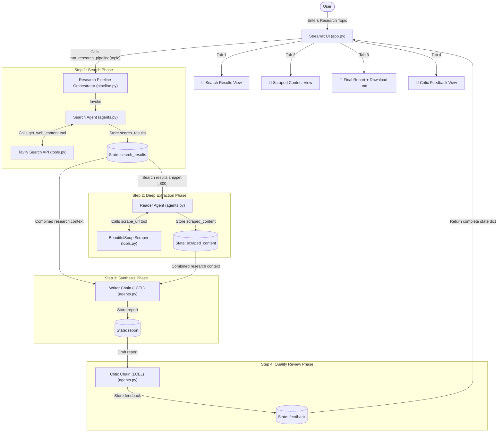

# 🔬 MultiAgentSystem: AI-Powered Multi-Agent Research Platform

[](https://www.python.org/)
[](https://python.langchain.com/)
[](https://streamlit.io/)
[](https://groq.com/)
[](https://tavily.com/)
[](LICENSE)

An intelligent, modular multi-agent research application designed to automate information discovery, deep-content extraction, document synthesis, and automated peer review. Built with **LangChain**, **Groq / Google Gemini**, **Tavily Search**, **BeautifulSoup4**, and **Streamlit**.

---

## 📑 Table of Contents

- [1. Project Overview](#1-project-overview)
- [2. Problem Statement](#2-problem-statement)
- [3. Key Features](#3-key-features)
- [4. Multi-Agent Architecture](#4-multi-agent-architecture)
- [5. Research Workflow](#5-research-workflow)
- [6. Technology Stack](#6-technology-stack)
- [7. Project Folder Structure](#7-project-folder-structure)
- [8. Installation and Setup](#8-installation-and-setup)
- [9. Environment Variables Configuration](#9-environment-variables-configuration)
- [10. How to Run the Application](#10-how-to-run-the-application)
- [11. How the Multi-Agent Pipeline Works](#11-how-the-multi-agent-pipeline-works)
- [12. Screenshots & Interface](#12-screenshots--interface)
- [13. Example Research Topics](#13-example-research-topics)
- [14. Current Limitations](#14-current-limitations)
- [15. Future Improvements & Roadmap](#15-future-improvements--roadmap)
- [16. Contributing](#16-contributing)
- [17. License](#17-license)

---

## 1. Project Overview

**MultiAgentSystem** is an end-to-end autonomous research application that bridges the gap between shallow search engine results and manual research synthesis. Given any user-defined topic, the system delegates responsibilities across a team of specialized AI agents:

1. **Search Agent:** Queries the web for high-relevance sources and gathers initial summaries via the Tavily AI Search API.
2. **Reader Agent:** Analyzes candidate URLs from the search results, selects the most relevant source, and scrapes its complete textual contents using BeautifulSoup.
3. **Writer Agent:** Aggregates search snippets and deep scraped content to synthesize a structured, publication-ready research report.
4. **Critic Agent:** Conducts a strict review of the generated report, scoring it out of 10 and offering structured critique on strengths and improvement areas.

The application provides an interactive, dark-themed **Streamlit** dashboard as well as a standalone command-line interface.

---

## 2. Problem Statement

Conducting thorough online research is traditionally a time-consuming, repetitive process:
- Users must manually craft queries, sift through search result pages, open multiple articles, and filter out advertisements, navigation bars, and irrelevant content.
- Standard large language models (LLMs) used in isolation suffer from static knowledge cutoffs and lack real-time web retrieval.
- Monolithic single-prompt AI systems often produce superficial summaries without verifying whether deep webpage content aligns with the topic.

**MultiAgentSystem** addresses these challenges by dividing the cognitive workload into distinct, specialized agents. Separating information retrieval, deep-page reading, report synthesis, and critical review ensures modularity, traceability, and structured output.

---

## 3. Key Features

- **Automated Web Search:** Queries Tavily's search engine to fetch up to 5 verified web sources with titles, links, and content snippets.
- **Targeted Web Scraping:** Uses BeautifulSoup to strip HTML boilerplate (scripts, styles, navbars, footers) and extract clean, readable text from target articles.
- **Structured Report Generation:** Enforces an academic report format consisting of:
  - Introduction
  - Key Findings (minimum 3 well-explained points)
  - Conclusion
  - Sources (compiled list of referenced URLs)
- **Automated Quality Review:** Employs an LLM-based Critic chain that rates the report on a 10-point rubric with actionable feedback and a final verdict.
- **Dual Execution Interfaces:**
  - **Streamlit Web UI:** Dark-themed dashboard with live execution spinners, stage status badges, multi-tab result views, and Markdown report export.
  - **CLI Pipeline:** Standalone Python script executable from any terminal.
- **Multi-Model Support:** Built on LangChain's unified `init_chat_model` interface, preconfigured for **Groq** (`openai/gpt-oss-20b`) with ready integration for **Google Gemini** (`gemini-3.8-flash`).

---

## 4. Multi-Agent Architecture

The system decouples agent responsibilities into ReAct tool-calling agents and LangChain Expression Language (LCEL) chains.



### Component Breakdown

| Component | Type | Responsibility | Underlying Tools / Models |
| :--- | :--- | :--- | :--- |
| **Search Agent** | LangChain Agent (`create_agent`) | Queries the web for recent, high-credibility information on the target topic. | `get_web_content` (TavilyClient API) |
| **Reader Agent** | LangChain Agent (`create_agent`) | Evaluates search URLs, picks the single most relevant page, and scrapes deep content. | `scrape_url` (Requests + BeautifulSoup4) |
| **Writer Agent** | LCEL Chain (`writer_prompt \| llm`) | Synthesizes search snippets and deep scraped body text into a formatted research report. | LLM (Groq / Gemini) + `StrOutputParser` |
| **Critic Agent** | LCEL Chain (`critic_prompt \| llm`) | Reviews the report for clarity, factual depth, and structure; assigns a score and verdict. | LLM (Groq / Gemini) + `StrOutputParser` |
| **Orchestrator** | Procedural State Pipeline | Manages execution sequence and passes data between agents in a shared dictionary. | Python `run_research_pipeline()` |
| **Web Interface** | Streamlit UI | Provides input controls, real-time spinner, multi-tab displays, and markdown file download. | Streamlit |

---

## 5. Research Workflow

The pipeline executes sequentially in four synchronized stages:

1. **Query Submission:** The user inputs a research topic via the Streamlit interface (e.g., *"What are the major reasons behind the downfall of gold and silver prices in India?"*).
2. **Search Retrieval (Step 1):** The Search Agent calls `get_web_content(query)` via the Tavily API, retrieving up to 5 structured results (Title, URL link, 300-character snippet).
3. **Deep Reading & Scraping (Step 2):** The Reader Agent inspects the top search results, identifies the single most relevant URL, and triggers `scrape_url(url)`. The tool downloads the HTML, eliminates boilerplate tags, and strips up to 3,000 characters of clean text.
4. **Report Drafting (Step 3):** The Writer Agent receives both the broad search snippets and the scraped body text. It generates a comprehensive report following the mandatory 4-part structure (Introduction, Key Findings, Conclusion, Sources).
5. **Peer Review & Feedback (Step 4):** The Critic Agent reads the completed report and generates a review containing a score out of 10, listed strengths, areas to improve, and a final one-line verdict.
6. **Result Presentation:** Streamlit populates 4 interactive tabs, displays stage completion checkmarks, and enables direct `.md` report download.

---

## 6. Technology Stack

| Category | Technology | Purpose |
| :--- | :--- | :--- |
| **Programming Language** | Python 3.10+ | Core runtime environment |
| **Agent Orchestration** | LangChain & LangGraph | Agent creation (`create_agent`) and LCEL prompt pipelines |
| **LLM Inference** | Groq (`openai/gpt-oss-20b`) / Google Gemini | High-speed LLM reasoning and structured generation |
| **Search Engine** | Tavily Search API (`tavily-python`) | AI-optimized web search for agent workflows |
| **Web Scraping** | BeautifulSoup4 & Requests | HTML parsing, DOM sanitization, and text extraction |
| **User Interface** | Streamlit | Reactive dark-themed dashboard and markdown exporter |
| **Environment Config** | Python-Dotenv | Secure local loading of API keys |
| **Console Formatting** | Rich | Formatted terminal output during execution |

---

## 7. Project Folder Structure

```plaintext
MultiAgentSystem/
│
├── .env                  # Environment variables file (API keys - DO NOT COMMIT)
├── .env.example          # Sample environment variables template
│
├── agents.py             # Agent definitions (Search, Reader) and LCEL chains (Writer, Critic)
├── tools.py              # Custom LangChain tools (Tavily search & BeautifulSoup scraper)
├── pipeline.py           # Sequential pipeline coordinator managing agent execution & state
├── app.py                # Streamlit web application with custom CSS and tabbed results UI
│
├── requirement.txt       # Project dependencies manifest
├── test.py               # Standalone test script to verify Gemini LLM connectivity
└── README.md             # Project documentation and setup guide
```

---

## 8. Installation and Setup

Follow these step-by-step instructions to set up and run the project locally on **Windows (PowerShell)**.

### Prerequisites

- **Python 3.10, 3.11, or 3.12** installed on your system ([Download Python](https://www.python.org/downloads/)).
- **Git** installed on your system ([Download Git](https://git-scm.com/)).
- Active API keys for **Tavily** and **Groq** (or **Google Gemini**).

### Step 1: Clone the Repository

Open Windows PowerShell and clone the project repository:

```powershell
git clone https://github.com/your-username/MultiAgentSystem.git
cd MultiAgentSystem
```

*(If setting up locally without Git, navigate directly to your project root folder).*

### Step 2: Create a Virtual Environment

Create an isolated Python virtual environment named `.venv`:

```powershell
python -m venv .venv
```

### Step 3: Activate the Virtual Environment

Enable script execution for the current session (if restricted) and activate the environment:

```powershell
Set-ExecutionPolicy -Scope Process -ExecutionPolicy Bypass
.\.venv\Scripts\Activate.ps1
```

When activated, you will see `(.venv)` at the beginning of your PowerShell prompt.

### Step 4: Install Dependencies

Install the core dependencies listed in `requirement.txt`:

```powershell
pip install -r requirement.txt
```

> [!IMPORTANT]
> **Additional Dependencies Notice:**
> The `app.py` user interface and active `agents.py` model configuration require `streamlit` and `langchain-groq`. If they are not yet in your environment, install them using:
> ```powershell
> pip install streamlit langchain-groq groq
> ```

---

## 9. Environment Variables Configuration

The application requires API keys to interact with the search engine and LLM providers.

### 1. Create a `.env` File

In the root directory of the project, create a file named `.env`:

```powershell
New-Item -Path .env -ItemType File
```

### 2. Configure Your API Keys

Open the `.env` file in your preferred text editor (e.g., VS Code or Notepad) and add your keys:

```ini
# ==========================================
# Search Engine API Key (Required)
# ==========================================
# Obtain from: https://app.tavily.com/
TAVILY_API_KEY=tvly-your-actual-tavily-api-key-here

# ==========================================
# Primary LLM Provider: Groq (Required for default setup)
# ==========================================
# Obtain from: https://console.groq.com/keys
GROQ_API_KEY=gsk_your-actual-groq-api-key-here

# ==========================================
# Alternative LLM Provider: Google Gemini (Optional)
# ==========================================
# Obtain from: https://aistudio.google.com/app/apikey
GOOGLE_API_KEY=AIzaSy-your-actual-google-gemini-key-here
```

> [!WARNING]
> **Security Best Practice:** Never commit your `.env` file or hardcode API keys into source files. Ensure `.env` is listed in your `.gitignore` file.

---

## 10. How to Run the Application

### Option A: Launch the Streamlit Web Application (Recommended)

To start the interactive web interface:

```powershell
streamlit run app.py
```

Streamlit will start a local web server and automatically open the application in your default browser at:
```
http://localhost:8501
```

### Option B: Run via the Command Line (CLI)

You can also run the research pipeline directly in your terminal:

```powershell
python pipeline.py
```

When prompted:
```plaintext
Enter a research topic : Impact of Solid-State Batteries on Electric Vehicles
```
The terminal will display live stage logs, raw search outputs, scraped page text, the generated report, and the critic review.

### Option C: Verify LLM Connectivity

To verify that your Google Gemini API key and environment are functioning properly:

```powershell
python test.py
```
*Expected output:* `Gemini is working`

---

## 11. How the Multi-Agent Pipeline Works

### 1. Search Tool (`tools.py`)
```python
@tool
def get_web_content(query: str) -> str:
    search_results = tavily.search(query, max_results=5)
    ...
```
- Calls `TavilyClient.search()` with `max_results=5`.
- Formats the results into clean text blocks with `Title:`, `Link:`, and a `Snippet:` truncated to 300 characters to conserve context tokens.

### 2. Web Scraping Tool (`tools.py`)
```python
@tool
def scrape_url(url: str) -> str:
    resp = requests.get(url, timeout=8, headers={"User-Agent": "Mozilla/5.0"})
    soup = BeautifulSoup(resp.text, "html.parser")
    for tag in soup(["script", "style", "nav", "footer"]):
        tag.decompose()
    return soup.get_text(separator=" ", strip=True)[:3000]
```
- Performs an HTTP `GET` request with an 8-second timeout and standard desktop User-Agent header.
- Decomposes non-content tags (`<script>`, `<style>`, `<nav>`, `<footer>`).
- Extracts whitespace-stripped text truncated to the first 3,000 characters.

### 3. Agent & Chain Configurations (`agents.py`)
- **Model Initializer:** Configured with `init_chat_model("groq:openai/gpt-oss-20b", temperature=0.3)`.
- **Search Agent:** Instantiated using `create_agent(model=llm, tools=[get_web_content])`.
- **Reader Agent:** Instantiated using `create_agent(model=llm, tools=[scrape_url])`.
- **Writer Chain:** LCEL sequence `writer_prompt | llm | StrOutputParser()` enforcing structured sections.
- **Critic Chain:** LCEL sequence `critic_prompt | llm | StrOutputParser()` enforcing scoring criteria.

### 4. Data Flow State (`pipeline.py`)
The pipeline coordinates execution using a shared state dictionary:
```python
state = {
    "search_results": "...",   # Captured from Search Agent's final message
    "scraped_content": "...",  # Captured from Reader Agent's final message
    "report": "...",           # Generated by Writer Chain
    "feedback": "..."          # Generated by Critic Chain
}
```

---

## 12. Screenshots & Interface

*Note: Below are placeholders for interface screenshots. Add your captured screenshots to an `assets/` or `images/` directory.*

### 1. Main Dashboard & Research Input

*The dark-themed landing view with the topic text area, sidebar workflow explanation, and Start Research button.*

### 2. Research Execution & Status Badges

*Live visual status indicators confirming completion of Search, Scraping, Report Generation, and Critic Review.*

### 3. Generated Report & Download

*Tab 3 displaying the final structured research report with the one-click `Download Research Report` button.*

### 4. Critic Review & Scoring

*Tab 4 displaying the Critic Agent's score out of 10, identified strengths, areas to improve, and verdict.*

---

## 13. Example Research Topics

Here are sample research prompts suited for testing the multi-agent system:

- **Economics & Markets:**
  > *"What are the major reasons behind the downfall of gold and silver prices in India?"*
- **Artificial Intelligence:**
  > *"Analyze the architectural differences and trade-offs between Mixture of Experts (MoE) and dense LLMs."*
- **Clean Energy:**
  > *"What are the technical bottlenecks in scaling green hydrogen production for commercial transport?"*
- **Biotechnology:**
  > *"Recent clinical trial breakthroughs in mRNA cancer vaccines over the past 12 months."*

---

## 14. Current Limitations

To maintain technical accuracy, the following boundaries of the current implementation should be noted:

- **Single-Page Deep Reading:** The Reader Agent selects and scrapes exactly one URL from the initial search results; it does not currently crawl multiple pages simultaneously.
- **Context Truncation Thresholds:**
  - Search snippets are capped at 300 characters each.
  - Reader Agent receives the first 800 characters of search output to select a URL.
  - Scraped body text is truncated to 3,000 characters to prevent token overflow.
- **Linear Execution without Feedback Loop:** The pipeline runs in a linear sequence: Search → Read → Write → Critique. The Critic reviews the report, but the system does not automatically cycle back to the Writer for iterative revisions.
- **Synchronous Scraping:** `scrape_url` runs synchronously with an 8-second timeout. Dynamic JavaScript-rendered websites (e.g., Single Page Apps) are not executed by the plain requests parser.
- **Dependency List Discrepancy:** The root `requirement.txt` file does not currently include `streamlit` or `langchain-groq`, which must be installed manually.

---

## 15. Future Improvements & Roadmap

- [ ] **Cyclic LangGraph Architecture:** Refactor the procedural pipeline into a formal LangGraph `StateGraph` with conditional edges enabling automatic report revision if the Critic's score falls below 7/10.
- [ ] **Multi-Source Parallel Scraping:** Expand the Reader Agent to scrape the top 3–5 candidate URLs concurrently using `asyncio` or `aiohttp`.
- [ ] **Headless Browser Scraping:** Integrate Playwright or Selenium to extract content from JavaScript-heavy single-page applications.
- [ ] **Dynamic Citation Footnotes:** Implement automated in-text citation markers `[1]`, `[2]` mapped directly to scraped source URLs.
- [ ] **Export Formats:** Add one-click export options for **PDF** and **DOCX** in addition to Markdown.
- [ ] **Human-in-the-Loop Validation:** Allow users to approve or alter the selected URLs before deep scraping begins.

---

## 16. Contributing

Contributions are welcome! To contribute to the project:

1. **Fork the Repository** on GitHub.
2. **Create a Feature Branch:**
   ```powershell
   git checkout -b feature/your-feature-name
   ```
3. **Commit Your Changes:**
   ```powershell
   git commit -m "Add: description of your feature"
   ```
4. **Push to the Branch:**
   ```powershell
   git push origin feature/your-feature-name
   ```
5. **Open a Pull Request** describing your changes and testing results.

---

## 17. License

This project is licensed under the **MIT License**. See the [LICENSE](LICENSE) file for details.

---

<p align="center">
  <b>MultiAgentSystem</b> • Developed as an AI Engineering & Multi-Agent Systems Portfolio Project
</p>
