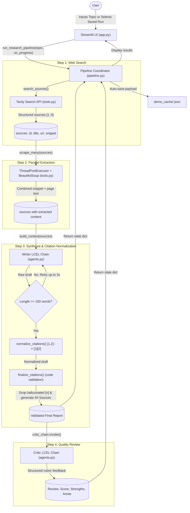

# 🔬 MultiAgentSystem: AI-Powered Multi-Agent Research Platform

[](https://www.python.org/)
[](https://python.langchain.com/)
[](https://streamlit.io/)
[-green.svg)](https://groq.com/)
[](https://tavily.com/)
[](LICENSE)

An intelligent, modular research platform designed to automate web discovery, concurrent source extraction, cited report synthesis, deterministic citation validation, and automated peer review. Built with **LangChain**, **Groq LLM**, **Tavily AI Search**, **BeautifulSoup4**, and **Streamlit**.

---

## 📑 Table of Contents

- [1. Quick Demo](#1-quick-demo)
- [2. Project Overview](#2-project-overview)
- [3. Problem Statement](#3-problem-statement)
- [4. Key Features](#4-key-features)
- [5. System Architecture](#5-system-architecture)
- [6. Research Workflow](#6-research-workflow)
- [7. Technology Stack](#7-technology-stack)
- [8. Project Folder Structure](#8-project-folder-structure)
- [9. Installation and Setup](#9-installation-and-setup)
- [10. Environment Variables Configuration](#10-environment-variables-configuration)
- [11. How to Run the Application](#11-how-to-run-the-application)
- [12. Screenshots & Interface](#12-screenshots--interface)
- [13. Evaluation Harness](#13-evaluation-harness)
- [14. Example Research Topics](#14-example-research-topics)
- [15. Current Limitations](#15-current-limitations)
- [16. Future Improvements & Roadmap](#16-future-improvements--roadmap)
- [17. Contributing](#17-contributing)
- [18. License](#18-license)

---

## 1. Quick Demo

Launch the entire demo with a single command on Windows:

```powershell
.\run_demo.ps1
```

This automated launcher executes:
1. Virtual environment activation (`.venv`).
2. Comprehensive preflight diagnostics (`preflight.py` verifying `.env` keys, Tavily DNS resolution, and Groq API connectivity).
3. Streamlit application launch (`streamlit run app.py`).

> [!TIP]
> **Offline Demo Mode:** If internet access is unavailable or API quotas are exhausted during a presentation, open the **Saved Demo Runs** dropdown in the Streamlit sidebar and click **Load Saved Run** to replay complete pre-generated research reports with zero network calls.

---

## 2. Project Overview

**MultiAgentSystem** automates the end-to-end technical research pipeline, bridging the gap between raw search results and synthesized, cited academic documents:

1. **Search Discovery:** Queries the Tavily Search API directly to retrieve up to 5 structured sources with title, URL, and contextual snippet.
2. **Parallel Source Extraction:** Scrapes all candidate pages concurrently using `ThreadPoolExecutor` and BeautifulSoup, combining search snippets with sanitized body text.
3. **Cited Report Writer:** Formulates a structured report enforcing strict inline numeric citations (`[1]`, `[2]`).
4. **Deterministic Citation Engine:** Validates citations in code, strips hallucinated reference numbers, and programmatically builds the official Sources list.
5. **Peer Review & Critic:** Evaluates the report for factual grounding, structure, and readability, returning a score out of 10 and qualitative critique.

---

## 3. Problem Statement

Manual research and single-prompt LLM generation face severe operational constraints:
- **Hallucination & Outdated Data:** Standard LLMs suffer from knowledge cutoff limits and fabricate facts when ungrounded.
- **Superficial Retrieval:** Generic search tools dump unstructured HTML or unvetted snippets that overflow token context windows.
- **Unreliable Citations:** Generative models frequently hallucinate non-existent URLs or misattribute claims to incorrect sources.
- **Presentation Failure Risk:** Live demonstrations frequently fail due to API rate limits, captive portal Wi-Fi restrictions, or dropped connections.

**MultiAgentSystem** resolves these issues through multi-step functional decomposition, concurrent data extraction, programmatic citation verification, and offline demo caching.

---

## 4. Key Features

- **Structured Search Integration:** Retrieves up to 5 verified sources with persistent numeric IDs (`[1]`, `[2]`).
- **Concurrent Web Scraping:** High-throughput `ThreadPoolExecutor` scraping with automated fallback to search snippets when pages are paywalled or block automated traffic.
- **Per-Sentence Citation Enforcement:** Prompt constraints require every factual assertion to cite its numbered source.
- **Deterministic Citation Finalizer:** Python regex engine verifies every `[n]` citation against valid source IDs and appends a verified markdown Sources section.
- **Offline Demo Replay:** Automatic JSON caching of successful runs to `demo_cache/` enabling instant offline presentation.
- **Live Progress Tracking:** Dynamic `st.status` widget updating step-by-step progress and total elapsed execution time.
- **Preflight Diagnostics:** Pre-demo testing script validating environment variables, Tavily DNS routing, and Groq LLM availability.

---

## 5. System Architecture



### Component Breakdown

| Component | Architecture Type | Implementation Responsibility | Source File |
| :--- | :--- | :--- | :--- |
| **Search Engine** | Direct API Retrieval | Queries Tavily API; assigns stable numeric IDs 1 to 5. | [tools.py](file:///c:/Users/HP/Desktop/MultiAgentSystem/tools.py) |
| **Parallel Scraper** | Concurrent ThreadPool | Concurrently requests pages; strips scripts/styles; caps text at 2,000 characters. | [tools.py](file:///c:/Users/HP/Desktop/MultiAgentSystem/tools.py) |
| **Writer Engine** | LCEL Chain + Retry Guard | Synthesizes findings with mandatory inline citations; retries up to 3 times if short. | [agents.py](file:///c:/Users/HP/Desktop/MultiAgentSystem/agents.py), [pipeline.py](file:///c:/Users/HP/Desktop/MultiAgentSystem/pipeline.py) |
| **Citation Finalizer** | Deterministic Code | Drops hallucinated citation IDs; generates exact `## Sources` markdown hyperlinks. | [pipeline.py](file:///c:/Users/HP/Desktop/MultiAgentSystem/pipeline.py) |
| **Critic Reviewer** | LCEL Chain | Audits report grounding and structure; outputs a 10-point score and actionable feedback. | [agents.py](file:///c:/Users/HP/Desktop/MultiAgentSystem/agents.py) |
| **Demo Cache Utility** | Serialization Engine | Generates slugs; auto-saves runs as JSON; loads saved runs for offline replay. | [demo_cache_utils.py](file:///c:/Users/HP/Desktop/MultiAgentSystem/demo_cache_utils.py) |
| **Web Dashboard** | Streamlit UI | Provides live execution progress, offline cache loading, and tabbed inspection. | [app.py](file:///c:/Users/HP/Desktop/MultiAgentSystem/app.py) |

---

## 6. Research Workflow

1. **Initialization:** The user submits a research topic or chooses an offline demo run from the sidebar.
2. **Step 1 - Search Retrieval:** `search_sources()` requests top 5 search hits from Tavily, creating structured dictionaries with numeric IDs.
3. **Step 2 - Concurrent Scraping:** `scrape_many()` uses 5 worker threads to scrape full HTML, removes boilerplate elements (`script`, `style`, `nav`, `footer`, `header`, `aside`), and extracts up to 2,000 characters combined with Tavily's snippet.
4. **Step 3 - Report Synthesis:** `write_report()` invokes `writer_chain` with numbered sources context. A verification loop checks that the draft contains $\ge 150$ words.
5. **Citation Normalization & Finalization:** Comma-separated citations (e.g. `[1, 2]`) are converted to `[1][2]`. Non-existent source numbers are deleted, and valid sources are compiled into `## Sources`.
6. **Step 4 - Critic Audit:** `critic_chain` evaluates the report and returns scores, strengths, weaknesses, and a concluding verdict.
7. **Cache & Render:** The completed run is auto-saved to `demo_cache/` and displayed across 4 interactive tabs.

---

## 7. Technology Stack

| Library / Tool | Pinned Version | Role |
| :--- | :--- | :--- |
| **Python** | 3.10+ | Execution runtime |
| **LangChain** | 1.5.2 | Agent primitives and LCEL prompt-to-model chains |
| **LangGraph** | 1.2.24 | Agent workflow graph foundation |
| **Groq / langchain-groq** | 1.7.0 / 1.2.1 | Fast LLM inference (`openai/gpt-oss-20b`) |
| **Tavily Python** | 0.8.5 | High-accuracy web search API |
| **BeautifulSoup4** | 4.15.0 | HTML parsing and text extraction |
| **Requests** | 2.34.2 | HTTP client for webpage scraping |
| **Streamlit** | 1.67.0 | Dark-mode interactive web dashboard |
| **Python-Dotenv** | 1.2.4 | Environment variable loader |
| **Rich** | 15.0.0 | Structured terminal logging |

---

## 8. Project Folder Structure

```plaintext
MultiAgentSystem/
│
├── .env                  # API keys (TAVILY_API_KEY, GROQ_API_KEY - DO NOT COMMIT)
├── .env.example          # Environment variable template
├── .gitignore            # Git exclusion rules (secrets, venv, caches)
│
├── app.py                # Streamlit web UI with live progress & offline replay
├── pipeline.py           # Pipeline orchestrator with progress callback & retry guards
├── agents.py             # LLM setup, writer chain, and critic chain
├── tools.py              # Tavily search & concurrent BeautifulSoup scraper
├── demo_cache_utils.py   # Shared JSON serialization & loading utilities
│
├── preflight.py          # Pre-demo diagnostic script (keys, DNS, LLM probe, cache)
├── make_demo_cache.py    # Batch script to pre-generate offline demo runs
├── test.py               # Quick Groq model connectivity test
├── run_demo.ps1          # One-click Windows PowerShell demo launcher
├── evaluate.py           # Empirical evaluation harness with --quick mode
│
├── requirements.txt      # Pinned dependency manifest
├── DEMO.md               # Faculty presentation guide, demo script & FAQ
└── README.md             # Project documentation
```

---

## 9. Installation and Setup

### Prerequisites
- Python 3.10, 3.11, or 3.12 installed on Windows.
- API keys for **Tavily** ([tavily.com](https://tavily.com)) and **Groq** ([console.groq.com](https://console.groq.com)).

### Step 1: Clone Repository
```powershell
git clone https://github.com/your-username/MultiAgentSystem.git
cd MultiAgentSystem
```

### Step 2: Create & Activate Virtual Environment
```powershell
python -m venv .venv
Set-ExecutionPolicy -Scope Process -ExecutionPolicy Bypass
.\.venv\Scripts\Activate.ps1
```

### Step 3: Install Dependencies
```powershell
pip install -r requirements.txt
```

---

## 10. Environment Variables Configuration

Create a `.env` file in the project root:

```ini
# ==========================================
# MultiAgentSystem API Keys
# ==========================================
TAVILY_API_KEY=tvly-your-actual-tavily-api-key-here
GROQ_API_KEY=gsk_your-actual-groq-api-key-here
```

---

## 11. How to Run the Application

### Option A: One-Click Demo Launcher (Recommended)
```powershell
.\run_demo.ps1
```

### Option B: Manual Streamlit Launch
```powershell
streamlit run app.py
```

### Option C: Diagnostic Preflight Verification
```powershell
python preflight.py
```

### Option D: Pre-Generate Demo Cache
```powershell
python make_demo_cache.py
```

---

## 12. Screenshots & Interface

> [!NOTE]
> Store actual captured interface screenshots in an `assets/` directory.

### 1. Main Dashboard & Topic Input

*Interactive topic submission with pre-configured example suggestions.*

### 2. Live Step Progress Tracking

*Real-time execution updates displaying search, scraping, writing, and review stages.*

### 3. Generated Report with Inline Citations

*Structured output displaying Introduction, Key Findings with inline citations, Conclusion, and markdown Sources.*

### 4. Critic Review & Offline Replay Sidebar

*Detailed 10-point evaluation and sidebar dropdown for instant offline presentation.*

---

## 13. Evaluation Harness

The repository includes a dedicated empirical evaluation harness ([evaluate.py](file:///c:/Users/HP/Desktop/MultiAgentSystem/evaluate.py)) designed to benchmark the system against a baseline single-prompt LLM across 18 diverse technical and economic topics.

### Tracked Metrics
- **Latency & Word Count:** Baseline vs. pipeline completion speed and output volume.
- **Scrape Success Rate:** Percentage of candidate URLs successfully scraped vs. snippet fallbacks.
- **Citation Coverage:** Percentage of factual sentences in Key Findings backed by inline citations.
- **Hallucinated Citation Rate:** Frequency of raw draft citations referencing non-existent sources.
- **Faithfulness (LLM-as-a-Judge):** Sentence-level verification using a secondary model (`qwen/qwen3.8-27b`) judging whether source text directly supports the generated claims.

> [!IMPORTANT]
> **Evaluation Status:** Full empirical evaluation is currently **in progress**. Run the quick 5-topic evaluation harness manually using:
> ```powershell
> python evaluate.py --quick
> ```

---

## 14. Example Research Topics

- **Financial Markets:** `Major reasons behind the recent fall in gold and silver prices in India`
- **AI Architectures:** `Mixture of Experts vs dense LLMs: architecture and trade-offs`
- **Fintech & Infrastructure:** `Impact of UPI on digital payments in India`
- **Biomedical Advances:** `Recent clinical trial progress in mRNA cancer vaccines`

---

## 15. Current Limitations

1. **LLM Provider Quota:** Reliance on developer-tier Groq API exposes the system to tokens-per-minute (TPM) limits on complex topics.
2. **Scraped Content Truncation:** Content is capped at 2,000 characters per page plus search snippets to prevent context window saturation.
3. **Linear Feedback Loop:** The Critic evaluates the draft but does not currently trigger automated iterative rewriting if the score falls below a threshold.
4. **Synchronous Requests:** Scraping uses a synchronous `requests` pool rather than an asynchronous event loop.

---

## 16. Future Improvements & Roadmap

- [ ] **Cyclic LangGraph Architecture:** Implement an iterative graph with conditional edges routing low-scoring reports back to the Writer with critic feedback.
- [ ] **Multi-Provider Fallback:** Automatically route queries to Google Gemini or local Ollama instances when Groq rate limits are hit.
- [ ] **Document Export:** Add one-click export to PDF and DOCX formats.
- [ ] **Interactive Citation Footnotes:** Hoverable citations displaying source excerpts directly in the UI.

---

## 17. Contributing

1. Fork the project on GitHub.
2. Create your feature branch (`git checkout -b feature/improvement`).
3. Commit your changes (`git commit -m 'feat: add feature'`).
4. Push to the branch (`git push origin feature/improvement`).
5. Open a Pull Request.

---

## 18. License

This project is licensed under the **MIT License**. See the [LICENSE](LICENSE) file for details.
